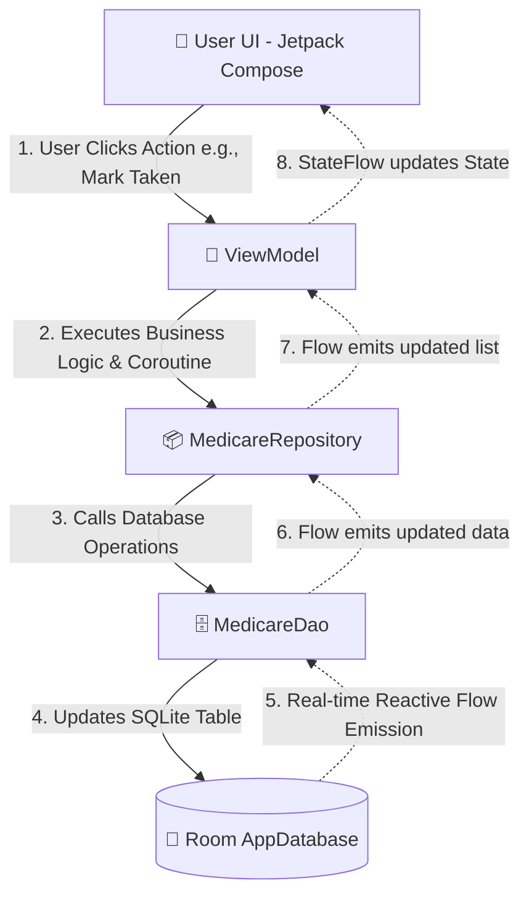
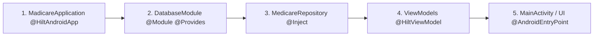
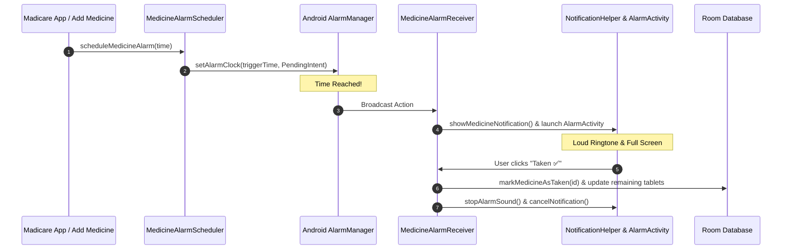
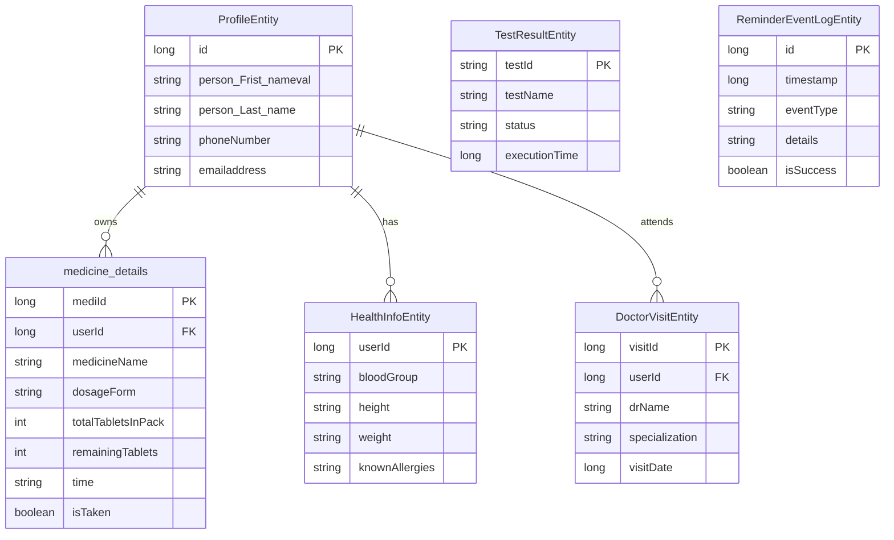

# 💊 Madicare - Medicine Tracker & Alarm Reminder App

**Madicare** is a complete, modern Android app built with **Kotlin** and **Jetpack Compose**. It helps users manage daily medications, receive loud full-screen alarm reminders, track remaining pill counts, log doctor visits, and monitor adherence statistics.

---

## 📑 Table of Contents
1. [✨ Feature Summary Table](#-feature-summary-table)
2. [🏗️ App Architecture & Data Flow](#️-app-architecture--data-flow)
3. [⚡ Hilt Dependency Injection (In Easy English)](#-hilt-dependency-injection-in-easy-english)
4. [🔔 How the Alarm & Notification System Works](#-how-the-alarm--notification-system-works)
5. [🗄️ Database Architecture (Room DB)](#️-database-architecture-room-db)
6. [📱 Screens & User Workflows](#-screens--user-workflows)
7. [🛠️ Tech Stack & Libraries](#️-tech-stack--libraries)
8. [🚀 How to Build & Run the App](#-how-to-build--run-the-app)

---

## ✨ Feature Summary Table

| Feature Category | Feature Name | Description | Key Code / Screen |
| :--- | :--- | :--- | :--- |
| **📅 Daily Tracker** | **Home Schedule** | Displays today's medicines grouped by schedule with real-time status (**Taken**, **Next**, **Upcoming**). Includes a weekly calendar selector. | [`Home.kt`](app/src/main/java/com/example/madicare/UI/home/Home.kt), [`HomeViewmodel.kt`](app/src/main/java/com/example/madicare/UI/home/HomeViewmodel.kt) |
| **💊 Medicine Management** | **My Medicines List** | View all stored medicines with status filters (**All**, **Active**, **Completed**) and pill count progress bars. | [`Mymedicine.kt`](app/src/main/java/com/example/madicare/UI/Medicines/Mymedicine.kt) |
| **➕ Custom Entry** | **Add / Edit Medicine** | Interactive form to enter medicine name, dosage, frequency, times of day, pill color, bottle graphics, and total pack count. | [`MedicineAdd.kt`](app/src/main/java/com/example/madicare/UI/Medicines/madicine_ADD/MedicineAdd.kt) |
| **🔎 Medicine Details** | **Detailed View** | Inspect remaining pill percentage, dosage instructions, schedule time, edit details, or delete medicine. | [`MedicineDetailsScreen.kt`](app/src/main/java/com/example/madicare/UI/MedicineDetails/MedicineDetailsScreen.kt) |
| **🚨 Alarms & Notifications** | **Full-Screen Alarm** | Triggers loud looping ringtone with full-screen activity over lock screen. Provides **Taken ✅**, **Not Taken ❌**, and **Snooze 💤 (5m)** buttons. | [`AlarmActivity.kt`](app/src/main/java/com/example/madicare/UI/alarm/AlarmActivity.kt), [`NotificationHelper.kt`](app/src/main/java/com/example/madicare/notification/NotificationHelper.kt) |
| **🧪 System Diagnostics** | **Reminder Test Hub** | Diagnostic tool to run instant alarm tests, background notification checks, and inspect execution logs in real-time. | [`ReminderTestScreen.kt`](app/src/main/java/com/example/madicare/UI/ReminderTest/ReminderTestScreen.kt) |
| **📊 Reports** | **Adherence Analytics** | Visual summary of overall dose compliance, taken vs missed history, and monthly adherence statistics. | [`Reportscreen.kt`](app/src/main/java/com/example/madicare/UI/report/Reportscreen.kt) |
| **👤 Profile & Health Info** | **User Profile & Health** | Manage personal information, blood group, height, weight, known allergies, and existing medical conditions. | [`MyProfile.kt`](app/src/main/java/com/example/madicare/Setting/settings/Profile/MyProfile.kt) |
| **🩺 Doctor Visits** | **Appointments & Doctors** | Track doctor visits, specialist contacts, clinic addresses, and prescription documents. | [`SettingsScreen.kt`](app/src/main/java/com/example/madicare/Setting/settings/SettingsScreen.kt) |

---

## 🏗️ App Architecture & Data Flow

Madicare is built following Android's official **MVVM (Model-View-ViewModel)** architecture and **Unidirectional Data Flow (UDF)**.

### 📐 Overall Data Flow Diagram



### 🔁 Plain Text Architecture Diagram

```
+-------------------------------------------------------------------+
|                            USER INTERFACE                         |
|                     (Jetpack Compose Screens)                     |
+----------------------------------+--------------------------------+
                                   |  Sends User Actions
                                   v  Observes UI State (StateFlow)
+----------------------------------+--------------------------------+
|                            VIEW MODEL                             |
|             (HomeViewModel, MedicineDetailsViewModel, etc.)       |
+----------------------------------+--------------------------------+
                                   |  Calls Repository
                                   v  Receives Reactive Data (Flow)
+----------------------------------+--------------------------------+
|                         MEDICARE REPOSITORY                       |
|                      (Single Source of Truth)                     |
+----------------------------------+--------------------------------+
                                   |  Queries / Updates Data
                                   v  
+----------------------------------+--------------------------------+
|                            ROOM DAO                               |
|                     (Data Access Object Interface)                |
+----------------------------------+--------------------------------+
                                   |  SQL Queries
                                   v  
+----------------------------------+--------------------------------+
|                         LOCAL ROOM DATABASE                       |
|                         (SQLite AppDatabase)                      |
+-------------------------------------------------------------------+
```

---

## ⚡ Hilt Dependency Injection (In Easy English)

### 💡 What is Hilt?
Imagine you go to a coffee shop:
- ❌ **Without Hilt (Manual Way)**: You have to grow coffee beans, roast them, buy a coffee machine, get milk from a farm, make the coffee yourself, and clean up.
- ✅ **With Hilt (Automatic Delivery)**: You just order *"One Cappuccino please!"*, and Hilt brings the ready-to-drink coffee straight to your table!

In Android programming, **Hilt** is your **automatic object delivery service**. Instead of manually creating database instances, DAO objects, and repositories everywhere, Hilt creates them behind the scenes and injects them where needed.

---

### 🛠️ How Hilt is wired in Madicare (Step-by-Step)



#### 1. **Application Class (`MadicareApplication.kt`)**
Annotated with `@HiltAndroidApp`. This starts Hilt's dependency tree as soon as the app starts up.
```kotlin
@HiltAndroidApp
class MadicareApplication : Application()
```

#### 2. **Hilt Module (`DatabaseModule.kt`)**
Annotated with `@Module` and `@InstallIn(SingletonComponent::class)`. Tells Hilt *how* to build the database and DAO.
```kotlin
@Module
@InstallIn(SingletonComponent::class)
object DatabaseModule {

    @Provides
    @Singleton
    fun provideAppDatabase(@ApplicationContext context: Context): AppDatabase {
        return AppDatabase.getDatabase(context)
    }

    @Provides
    fun provideMedicareDao(database: AppDatabase): MedicareDao {
        return database.medicareDao()
    }
}
```

#### 3. **Repository (`MedicareRepository.kt`)**
Annotated with `@Inject constructor(...)`. Tells Hilt: *"Please automatically give me the `MedicareDao` when creating this Repository."*
```kotlin
@Singleton
class MedicareRepository @Inject constructor(
    private val dao: MedicareDao
)
```

#### 4. **ViewModel Injection (`HomeViewModel.kt`, etc.)**
Annotated with `@HiltViewModel` and `@Inject constructor(...)`. Hilt automatically supplies the `MedicareRepository` into the ViewModel.
```kotlin
@HiltViewModel
class HomeViewModel @Inject constructor(
    private val repository: MedicareRepository
) : ViewModel()
```

#### 5. **UI & Activity (`MainActivity.kt`, `AlarmActivity.kt`)**
Annotated with `@AndroidEntryPoint`. Connects Hilt to the screen, allowing you to get a ViewModel in Compose with **1 line of code**:
```kotlin
val homeViewModel: HomeViewModel = hiltViewModel()
```

---

## 🔔 How the Alarm & Notification System Works

Madicare includes an exact, reliable alarm system for medicine reminders, even when the app is closed or the device restarts.



### Key Notification Components
1. **`MedicineAlarmScheduler.kt`**: Uses Android's `AlarmManager.setAlarmClock()` to set high-precision exact alarms. Handles pre-reminders and snooze intervals (e.g. 5 minutes).
2. **`MedicineAlarmReceiver.kt`**: Listens for system alarms, phone reboots (`BOOT_COMPLETED`), and notification button actions (**Taken**, **Not Taken**, **Snooze**).
3. **`NotificationHelper.kt`**: Creates high-priority notification channels (`IMPORTANCE_HIGH`), plays looping alarm ringtones, and launches full-screen intents.
4. **`AlarmActivity.kt`**: Full-screen dialog that pops up over the lock screen (`turnScreenOn`, `showWhenLocked`) with sound controls and response buttons.

---

## 🗄️ Database Architecture (Room DB)

Madicare uses **Room Database** (SQLite abstraction) with **6 key tables**:



### Table Overview
1. **`medicine_details`**: Stores medicine names, strength, dosage format, time schedules, bottle colors, remaining pills, and taken status.
2. **`Profile_details`**: Stores user profile details (first name, last name, phone, email, avatar).
3. **`health_info`**: Stores health metrics like blood group, height, weight, and allergies.
4. **`doctor_visits`**: Stores doctor appointment records, clinic addresses, contact details, and prescription notes.
5. **`test_results`**: Records results from the in-app System Diagnostic Test Hub.
6. **`reminder_event_logs`**: Logs all system alarm events for debugging notification performance.

---

## 📱 Screens & User Workflows

```
┌────────────────────────────────────────────────────────────────────────┐
│                              MAIN NAVIGATION                           │
├──────────────┬──────────────────┬──────────────┬────────┬──────────────┤
│  📅 Home     │  💊 My Medicines │  📊 Reports  │ 🧪 Test│  ⚙️ Settings  │
└──────┬───────┴────────┬─────────┴──────┬───────┴───┬────┴──────┬───────┘
       │                │                │           │           │
       ▼                ▼                ▼           ▼           ▼
  Daily Schedule   Medicine Cards   Adherence    Diagnostic   Profile, Health
  & Calendar Date   & Fill Progress  Statistics   Test Suite   & Doctor Visits
  Selector         & Add Medicine                & Event Logs  Management
```

1. **Home Screen (`Home.kt`)**: Quick glance at today's schedule. Mark dose as taken directly from card.
2. **My Medicines (`Mymedicine.kt`)**: Manage medicine inventory. Filter by **Active**, **Completed**, or **All**.
3. **Add Medicine (`MedicineAdd.kt`)**: Custom setup wizard for adding new pills, strength, schedule times, bottle icon, and pill colors.
4. **Medicine Details (`MedicineDetailsScreen.kt`)**: Displays total pack progress bar, scheduled times, notes, edit, and delete options.
5. **Alarm Screen (`AlarmActivity.kt`)**: High-priority alarm display when a reminder triggers.
6. **System Diagnostics (`ReminderTestScreen.kt`)**: Tests exact alarm permissions, notification channels, and trigger latency.
7. **Reports (`Reportscreen.kt`)**: Analyzes medicine adherence trends.
8. **Settings & Profile (`SettingsScreen.kt`, `MyProfile.kt`)**: Profile edits, health conditions, and doctor appointment tracking.

---

## 🛠️ Tech Stack & Libraries

| Technology / Library | Usage in Madicare |
| :--- | :--- |
| **[Kotlin](https://kotlinlang.org/)** | 100% Kotlin codebase |
| **[Jetpack Compose](https://developer.android.com/jetpack/compose)** | Modern declarative UI framework |
| **[Material 3](https://m3.material.io/)** | Design components, dynamic colors, cards, and bottom sheets |
| **[Hilt / Dagger](https://developer.android.com/training/dependency-injection/hilt-android)** | Automated dependency injection |
| **[Room Database](https://developer.android.com/training/data-storage/room)** | Local SQLite data persistence |
| **[Coroutines & Flow](https://kotlinlang.org/docs/coroutines-overview.html)** | Async background tasks & real-time reactive streams |
| **[Jetpack Navigation](https://developer.android.com/guide/navigation)** | Single-activity screen routing with `NavHost` |
| **[Android AlarmManager](https://developer.android.com/training/scheduling/alarms)** | System exact alarm scheduling |

---

## 🚀 How to Build & Run the App

### Prerequisites
- **Android Studio**: Ladybug / Jellyfish or newer.
- **JDK**: JDK 11 (configured in Gradle settings).
- **Minimum SDK**: API 24 (Android 7.0 Nougat).
- **Target SDK**: API 37.

### Step-by-Step Instructions
1. **Clone or Open the Project**:
   - Open **Android Studio**.
   - Select **File > Open** and choose the `Madicare` root folder.
2. **Sync Project with Gradle Files**:
   - Allow Gradle to download dependencies automatically.
3. **Select Target Device**:
   - Launch an Android Emulator or connect a physical Android device via USB debugging.
4. **Run Application**:
   - Press **`Shift + F10`** or click the green **Play (▶️)** button in Android Studio.
5. **Permissions**:
   - Grant **Notification permission** (`POST_NOTIFICATIONS`) and **Exact Alarm permission** (`SCHEDULE_EXACT_ALARM`) when prompted for full alarm functionality.

---

*Developed for reliable, easy daily health management.* 💊
